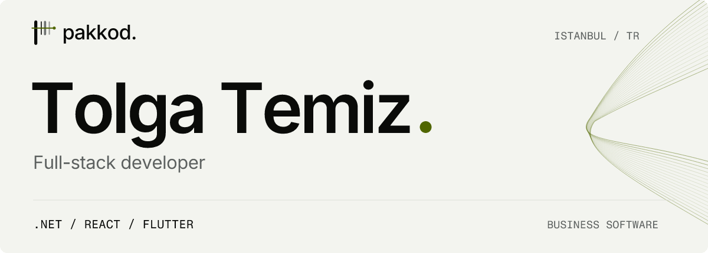
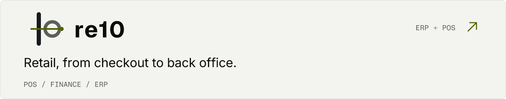
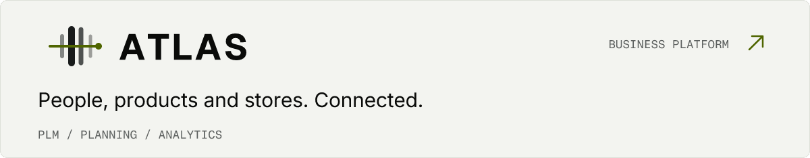

<picture>
  <source media="(prefers-color-scheme: dark)" srcset="./assets/motion/dark.gif">
  <source media="(prefers-color-scheme: light)" srcset="./assets/motion/light.gif">
  
</picture>

 

I’m **Tolga**, a full-stack developer based in **Istanbul, Türkiye**. At [Pakkod](https://pakkod.com), I build business software across **.NET**, **React** and **Flutter**, with a focus on retail operations and connected business workflows.

[Email](mailto:tolga@pakkod.com) &nbsp; / &nbsp; [LinkedIn](https://www.linkedin.com/in/tolga-temiz-66a1b1b3/) &nbsp; / &nbsp; [Pakkod](https://pakkod.com)

### My toolkit

**Backend** &nbsp; `C#` `.NET` `EF Core`  
**Web** &nbsp; `React` `TypeScript` `Next.js`  
**Mobile** &nbsp; `Flutter` `Dart` `Firebase`  
**Data** &nbsp; `SQL Server` `PostgreSQL` `MySQL`

More tools I’ve worked with

 

`Node.js` `JavaScript` `Tailwind CSS` `Angular` `Vue.js` `React Native` `Android` `Django` `SQLite` `Git` `Postman` `HTML` `CSS` `Arduino` `Blender`

---

### What I’m building at Pakkod

<a href="https://pakkod.com/urunler/re10">
  <picture>
    <source media="(prefers-color-scheme: dark)" srcset="./assets/motion/re10-dark.gif">
    <source media="(prefers-color-scheme: light)" srcset="./assets/motion/re10-light.gif">
    
  </picture>
</a>

**re10 ERP + POS** brings store sales, products, pricing, campaigns, customers and finance into one workflow, with Nebim V3 integration.

[Explore re10 →](https://pakkod.com/urunler/re10)

 

<a href="https://pakkod.com/urunler/atlas">
  <picture>
    <source media="(prefers-color-scheme: dark)" srcset="./assets/motion/atlas-dark.gif">
    <source media="(prefers-color-scheme: light)" srcset="./assets/motion/atlas-light.gif">
    
  </picture>
</a>

**ATLAS** connects textile and retail teams through PLM, production, reporting, replenishment and marketplace analytics. **Permini** supports personnel budgeting; **Store Management** brings store feedback and checklists into the platform.

[Explore ATLAS →](https://pakkod.com/urunler/atlas)

---

<a href="https://pakkod.com">pakkod.</a> &nbsp; · &nbsp; Pak kod, net iş.

